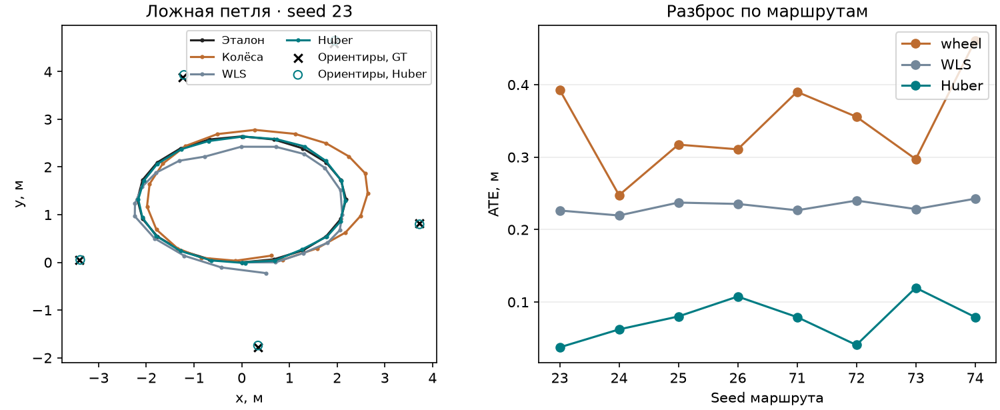
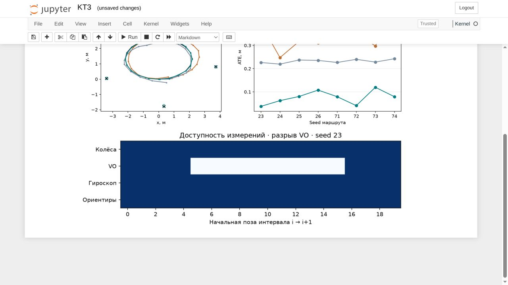

# КТ3 · Как выброс в датчике искажает маршрут

**Вопрос.** В каких условиях робастное объединение измерений улучшает карту? Проверяем прогноз, что на испорченных наблюдениях Huber уменьшит медианную ATE относительно WLS. Сравнение ведётся попарно на одинаковых маршрутах. Без выбросов ожидается близкая ошибка двух оценок.

## Состояние и измерения

Маршрут состоит из 21 позы, связанных 20 интервалами по 1 с. Пять ориентиров наблюдаются по дальности и пеленгу с известными идентификаторами. Первая поза закреплена. Вектор из 71 неизвестной содержит 20 свободных поз по три компоненты, десять координат карты и смещение гироскопа. Относительный перенос предсказывается как R(θᵢ)ᵀ(tⱼ − tᵢ). Для гироскопа прогноз равен wrap(θⱼ − θᵢ + b·Δt). Для ориентира прогнозируются длина вектора от робота и его направление относительно передней оси.

Задаём отдельное σ для каждой компоненты. WLS минимизирует половину суммы квадратов нормированных невязок. В варианте Хьюбера длина всего блока наблюдения сравнивается с порогом 2,5. Для нормированного блока длины s вес равен min(1, 2,5/s), при s = 0 берётся единица. На каждой итерации решаем (JᵀWJ + λD)Δ = −JᵀWr. D — положительная диагональ нормальной матрицы с нижней границей. Оценку обновляем при фактическом уменьшении выбранной цели.

## Измеренные ошибки

Seed маршрутов — 23–26 и 71–74. Во всех сценариях у колёс есть систематическая ошибка, а часть VO пропущена. В чистом сценарии отсутствуют добавочные крупные выбросы. Остальные сценарии включают выбросы дальности и пеленга. «Разрыв VO» дополнительно убирает середину визуальной последовательности. «Ложная петля» задаёт смещённую относительную позу между началом и концом. Общее начало координат задано конструкцией стенда, дополнительного выравнивания нет.

| Условия | ATE колёс, м | ATE WLS, м | ATE Huber, м | RPE Huber за 1 с, м | RMSE карты Huber, м |
|---|---:|---:|---:|---:|---:|
| Чистые | 0,337 | 0,057 | 0,057 | 0,036 | 0,060 |
| Выбросы | 0,337 | 0,392 | 0,073 | 0,038 | 0,086 |
| Разрыв VO | 0,337 | 0,411 | 0,075 | 0,047 | 0,084 |
| Ложная петля | 0,337 | 0,232 | 0,079 | 0,041 | 0,077 |

Здесь и далее по серии приведены медианы маршрутных RMSE. ATE измеряет ошибку положения относительно истины по всем позам. RPE сравнивает перенос за шаг в осях начальной позы каждого интервала. Ошибка карты измеряется по пяти соответствующим ориентирам. При выбросах ATE Huber лежала в диапазоне 0,034–0,092 м и оказалась меньше WLS на всех восьми маршрутах. Удаление верной петли увеличило медиану с 0,073 до 0,093 м. При ложной петле её удаление улучшило ATE на трёх из восьми маршрутов. Доля доступных приращений VO в медиане упала с 85% до 45% в сценарии разрыва.

## Проверки и область применимости

Численно проверены все столбцы аналитического якобиана, композиция рамок и угловой переход через ±π. Валидатор отбрасывает неверный индекс, неположительное σ, NaN и неверную размерность. Для нулевой дальности предсказанный пеленг неопределён, линеаризация сообщает об ошибке. На seed 23 с ложной петлёй собственный WLS дал цель 1774,23320455. SciPy с той же функцией невязок и численной оценкой производных дал 1774,23320421. Разница по максимальной компоненте состояния 0,0000311.

В линейной задаче с H положительно определённой итерация xₖ₊₁ = xₖ − α(Hxₖ − b) сжимает расстояния при 0 < α < 2/λₘₐₓ(H). Коэффициент в евклидовой норме равен maxᵢ|1 − αλᵢ(H)|. В тесте это свойство проверено на двух неизвестных. В нелинейном графе J меняется, поэтому на принятых шагах здесь гарантируется уменьшение цели. На чистых данных WLS обошёл Huber на пяти маршрутах из восьми с малыми различиями. Ошибочные соответствия, общая систематическая ошибка каналов и потеря наблюдаемости требуют отдельных проверок. Этот стенд предполагает известные ассоциации и синхронизированные интервалы.

На маршруте 23 камера пропустила 11 измерений подряд, от перехода 5→6 до 15→16 включительно. На каждом из этих переходов сохранились колёса, гироскоп и два наблюдения ориентиров у начальной позы. Это объясняет, за счёт чего граф всё ещё связывает две стороны разрыва.

Проверил и вариант, в котором Huber применяется только к VO, петлям и ориентирам. Колёсные и гироскопические измерения в нём сохраняют квадратичную потерю. На 32 сочетаниях маршрута и сценария максимальное расхождение ATE с вариантом для всех датчиков составило 0,000034 м. По этой серии выбрать между двумя вариантами по точности нельзя.
