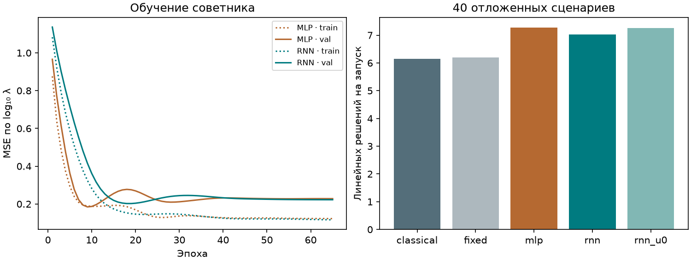
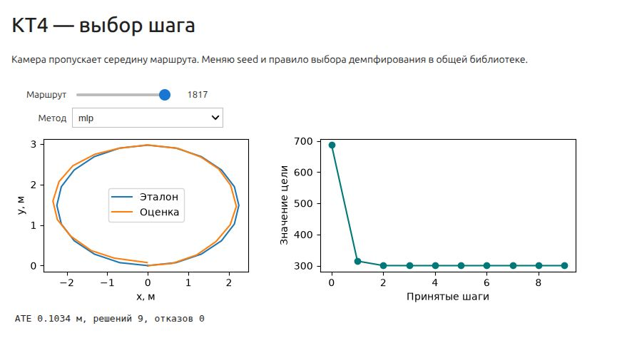

# КТ4 · Стоит ли доверить сети выбор демпфирования?

На 40 новых сочетаниях маршрута и сценария классический адаптивный LM потребовал в среднем 6,150 линейного решения на запуск, MLP — 7,275, RNN — 7,025. При близкой ошибке траектории для базовой конфигурации оставляю классическое правило. Оба обученных советника доступны для встраивания в тот же решатель КТ3.

## Откуда берётся совет

Вход содержит логарифм нормы градиента, логарифм нормы нормированной невязки, логарифм отношения крайних диагональных элементов H, долю ослабленных блоков Хьюбера, предыдущий log₁₀ λ и отношение фактического спуска к предсказанному. Смещение гироскопа, истинные позы, координаты ориентиров и признак искусственного выброса в этот вход не входят.

Советник принимает шесть конечных чисел. При ошибке размерности или пропуске значения состояние памяти сохраняется до следующего корректного вызова.

Учитель пробует восемь λ от 10⁻⁵ до 10 и вычисляет фактический спуск целевой функции. Метка — наибольшее λ среди предложений, сохранивших не менее 95% лучшего спуска. Обучение проводилось на 20 маршрутах (130 шагов), валидация на шести других (36 шагов). Нормировка вычислена на обучении. Для каждой архитектуры проверены ширины 8, 12, 16 и шаги Adam 0,006, 0,014, 0,025. У каждой из 18 конфигураций сохранялась лучшая по валидационной MSE эпоха из 65. Сравнение в таблице `results/selection.csv` выполнено до финального теста.

| Выбранная сеть | Скрытых единиц | Шаг Adam | Эпоха | MSE train | MSE validation |
|---|---:|---:|---:|---:|---:|
| MLP | 12 | 0,014 | 9 | 0,1892 | 0,1847 |
| Локальная RNN | 12 | 0,006 | 19 | 0,1489 | 0,2024 |

MSE вычислена для log₁₀ λ. Увеличение MLP с 12 до 16 единиц при шаге 0,014 ухудшило валидационную MSE с 0,185 до 0,232. Выбор опирается на независимые маршруты валидации. Финальный набор 1810–1817 выделен после пилотного запуска и впервые оценён после сохранения выбранных весов.

У RNN скрытое состояние обновляется по формуле hₖ = tanh(Wsₖ + u ⊙ hₖ₋₁ + b). Максимальный модуль u после обучения составил 0,327 при ограничении 0,8. При одинаковом входе расхождение двух состояний после шага не больше ‖u‖∞, умноженной на предыдущее расхождение в ∞-норме. Это следует из липшицевости tanh с константой 1. Память сбрасывается в начале каждого маршрута.

## Сравнение при одном бюджете

Восемь новых seed 1810–1817 проверены в пяти условиях. Пятое условие меняет геометрию маршрута, уменьшая его поперечный размер. Все методы получают один и тот же граф, начальное состояние, порог Хьюбера 2,5 и бюджет 24 линейных решений. Стартовое λ = 0,0003 выбрано по среднему числу решений классического метода на валидации. Политика fixed использует постоянное первое предложение с общим резервным увеличением при отказе. В RNN u=0 занулялись только рекуррентные веса уже обученной модели.

| Политика | Средняя ATE, м | Средняя RPE, м | Решений на запуск | Среднее время на стенде, мс |
|---|---:|---:|---:|---:|
| Классический LM | 0,0655 | 0,0400 | 6,150 | 7,70 |
| Fixed | 0,0655 | 0,0400 | 6,200 | 7,66 |
| MLP | 0,0655 | 0,0400 | 7,275 | 8,76 |
| Локальная RNN | 0,0655 | 0,0400 | 7,025 | 8,49 |
| RNN с u = 0 | 0,0655 | 0,0400 | 7,250 | 8,76 |

На восьми маршрутах с разрывом VO память сократила средние затраты с 7,250 решений у RNN с u = 0 до 6,750 у обученной RNN. Классический метод использовал 6,125. По всем 40 сочетаниям RNN сравнялась с классикой по числу решений 14 раз и потребовала больше решений 26 раз. В таблице каждая пара «seed, условие» имеет одинаковый вес; один и тот же seed повторяется в разных условиях. Время зависит от оборудования. Остановка всех 200 штатных вычислений произошла по малому снижению цели.

## Что происходит при плохом совете

Решатель принимает шаг только при конечном и строго меньшем значении цели. При отказе увеличивает λ до десятикратного значения в пределах установленного диапазона. Для отдельной отрицательной проверки начальная оценка маршрута 1620 намеренно искажена; при λ = 10⁻⁷ и бюджете 1 испытание отвергло шаг и вернуло начальную оценку без изменений со статусом `budget`. Проверены сброс памяти, загрузка весов и недопустимое предложение NaN. Уменьшение согласованной невязки само по себе не устанавливает физическую правильность карты.

## Что изменилось при плохой начальной позе

На шести новых маршрутах проверил два изменения. Включал выбросы дальности и пеленга и отдельно искажал начальные позы шумом в 0,9 м по координатам и 0,6 рад по курсу. Веса сетей взял из предыдущего опыта. В каждой из четырёх комбинаций методы получали одинаковые данные. За один запуск допускалось 24 решения системы.

| Условия | LM, решений | MLP, решений | RNN, решений | Медиана ATE у RNN, м |
|---|---:|---:|---:|---:|
| Чистые, старт по колёсам | 5,5 | 7 | 7 | 0,053 |
| Выбросы, старт по колёсам | 5,5 | 6,5 | 6 | 0,095 |
| Чистые, искажённый старт | 7,5 | 9 | 8,5 | 0,053 |
| Выбросы, искажённый старт | 7,5 | 8,5 | 8 | 0,095 |

Ожидал, что при плохом старте выбросы увеличат число решений у RNN. Получилось 8 против 8,5 на чистых измерениях. Ошибка пути при этом выросла. В самом трудном условии диапазон ATE всех трёх методов составил 0,064–0,101 м. LM потребовал 6–10 решений, RNN — 6–11, MLP — 7–11. За 72 запуска валидатор принял все предложенные шаги. Для худшего по возмущениям условия медиана числа вычислений функции потерь составила 16 у LM, 18 у MLP и 17 у RNN.

На исходном приближении маршрута 2601 я сверил градиент цели с центральными разностями по всем координатам. Относительное расхождение составило 1,54·10⁻¹⁰. Скалярное произведение градиента на шаг было −766,43, а цель уменьшилась с 843,36 до 345,06.

