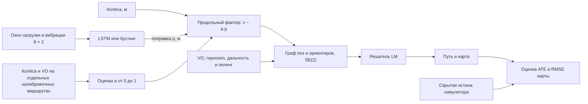
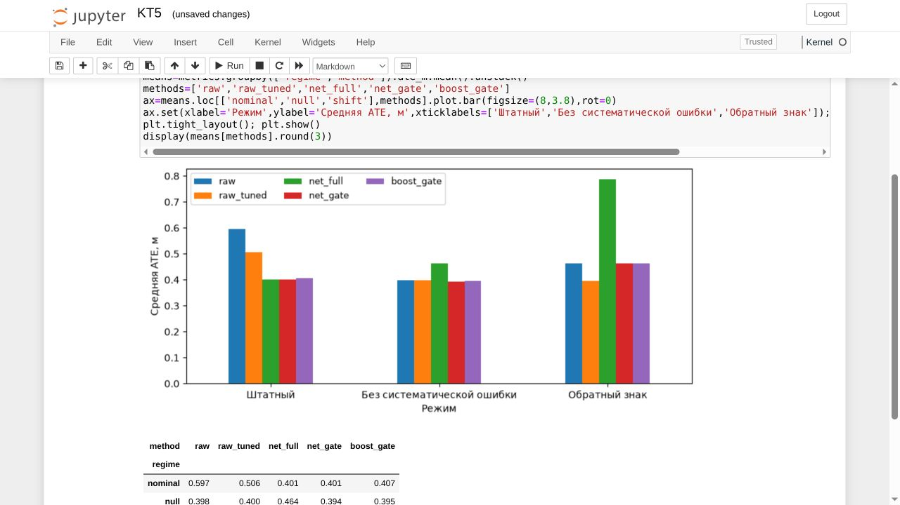

# КТ5 · Когда поправка к колёсной одометрии помогает карте

В штатном режиме оставляю калиброванную LSTM. При смене знака ошибки её полная поправка увеличила среднюю ATE с 0,462 до 0,789 м. Калибратор вернул коэффициент ноль и исходную ATE с тем же весом колёс. Если для новых условий ещё нет пригодных пар «колёса и VO», выбираю нулевое доверие до следующей калибровки.

## Функциональная схема

## F10 · Ошибка измерения и ошибка карты

Из трёх сетей в F9 наименьшую ошибку колёс на валидации дала LSTM — 0,0920 м. У CNN вышло 0,0972 м, у MLP — 0,1136 м. Этот выбор сделал до проверки F12. Бустинг с RMSE 0,0836 м проверял отдельно.

LSTM предсказывает знаковую продольную ошибку колёс в метрах за интервал по текущему и семи прошлым отсчётам. Выход ограничивается диапазоном ±0,55 м. Адаптер создаёт новый граф. Для камеры, гироскопа и ориентиров измерения сохраняются. Сравниваемые методы получают одно начальное приближение, построенное по исходным измерениям.

На учебном маршруте 23 полная поправка ухудшила ATE с 0,280 до 0,432 м, RMSE карты выросла с 0,248 до 0,424 м. На пяти валидационных маршрутах 2000–2004 средняя ATE, напротив, снизилась с 0,778 до 0,310 м, ошибка карты с 0,760 до 0,299 м. Простейший контрпример поясняет расхождение. У двух равновесных измерений ошибки +1 и −1 м в среднем компенсируются. После изменения обеих ошибок до +0,5 м их RMSE стала меньше, а смещение оценки выросло до 0,5 м.

## F11 · Как подбирать доверие к поправке

Для синхронных интервалов обозначим через dᵢ разность продольных приращений колёс и VO в осях корпуса, через pᵢ — прогноз ошибки от модели. Оба значения измеряются в метрах за интервал. Минимизируем J(a) = Σ(dᵢ − a·pᵢ)² при 0 ≤ a ≤ 1. Если Σpᵢ² > 0, производная обращается в ноль при a₀ = Σpᵢdᵢ / Σpᵢ². Квадратичная функция выпукла, поэтому a* получается ограничением a₀ на отрезок [0, 1]. Следовательно, J(a*) ≤ J(0) на этих калибровочных парах. На независимых маршрутах ATE может вырасти.

Калибровка использует восемь маршрутов 4000–4007, по 85 синхронных пар в каждом режиме. Общие начальная и конечная метки интервала обязательны. Модель и масштаб шума фиксируются до теста. Коэффициенты подобраны отдельно для известных режимов стенда.

| Режим | a* LSTM | a* бустинга | MSE до, м² | MSE после LSTM, м² |
|---|---:|---:|---:|---:|
| Штатный | 1,000 | 1,000 | 0,07529 | 0,01311 |
| Нет систематической ошибки | 0,047 | 0,042 | 0,00781 | 0,00770 |
| Обратный знак | 0,000 | 0,000 | 0,06398 | 0,06398 |

## F12 · Испытание на отложенных маршрутах

Прогноз до опыта состоял в том, что штатная поправка уменьшит дрейф, а при обратном знаке полная поправка его усилит. Проверка охватывает seed 5000–5004 в каждом режиме. У raw, полной и калиброванной коррекций σ продольного колёсного фактора равно 0,15 м. У raw tuned используется 0,60 м из отдельной валидации стенда. Все методы включают остальные факторы и тот же решатель. Числа в таблице — средние маршрутные ATE, м.

| Режим | Raw | Raw tuned | LSTM полная | LSTM с a* | Бустинг полный | Бустинг с a* |
|---|---:|---:|---:|---:|---:|---:|
| Штатный | 0,597 | 0,506 | 0,401 | 0,401 | 0,407 | 0,407 |
| Нет ошибки | 0,398 | 0,400 | 0,464 | 0,394 | 0,447 | 0,395 |
| Обратный знак | 0,462 | 0,397 | 0,789 | 0,462 | 0,759 | 0,462 |

В штатном режиме LSTM с a* обошла raw tuned на четырёх маршрутах из пяти. В режиме без ошибки — на трёх, при обратном знаке — на одном. Средняя ошибка карты у калиброванной LSTM по трём режимам составила соответственно 0,394, 0,386 и 0,457 м. Все 90 строк вошли в таблицу, включая три достижения лимита итераций у методов с полной поправкой. Доказанное ограничение относится к межсенсорной невязке на калибровке. На роботе придётся проверить согласованность осей и часов и убедиться, что сама VO пригодна как опора.

## Встраивание в КТ3 и КТ4

Функция `fusionlab.wheel_channel.correct_graph` принимает граф КТ3, прогноз, коэффициент доверия и σ. В отдельном опыте на seed 6021 те же измерения F9 обрабатывает наша библиотека КТ3. Гироскопическое смещение в ней оценивается по собственным факторам; дополнительный априорный фактор стенда F9 при переносе опущен. Начальная оценка одинакова для базового и исправленного вариантов.

У классического LM на штатном маршруте ATE изменилась с 0,431 до 0,170 м. При обратном знаке коэффициент нулевой, оба результата равны 0,532 м. Без систематической ошибки малая поправка ухудшила ATE с 0,181 до 0,190 м. Восемнадцать результатов в `integration.csv` включают также MLP и RNN из КТ4. На штатном маршруте оба советника израсходовали бюджет 24 решений. Это измеримый предел переноса на другой генератор.

Закрепление первой позы задаёт начало координат. Ошибка датчика остаётся частью измерения. Теорема Банаха гарантирует сходимость итераций оператора-сжатия в полном пространстве; её линейный пример и условия приведены в КТ3. Ошибка карты зависит также от геометрии, весов и направлений ошибок. Формула a* гарантирует оптимум по доступным калибровочным парам. Без подходящих пар калибратор возвращает a = 0. По умолчанию адаптер сохраняет колёсное приращение и заданный вес фактора. Это отдельно проверено на новом маршруте 6000 со сменой знака.
